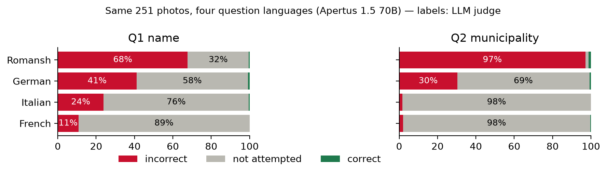
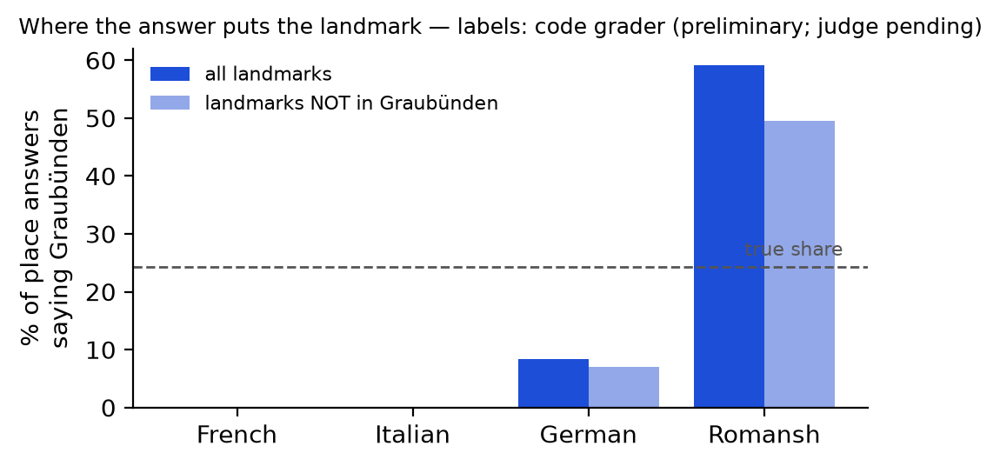
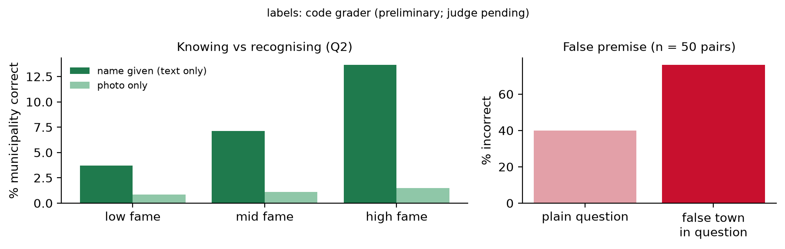

# Technical report — Swiss Heritage Factuality: does Apertus recognise Switzerland's landmarks?

> **Status 15 Oct.** Final labels are the frozen LLM judge's (`judge-v1`). Photos were screened by AI (see
> Annotation); the blind human audit of the 20 % sample is ⟨pending⟩.

> We built a four-language (FR/DE/IT/RM) benchmark of 3,412 questions about 251 Swiss heritage landmarks from the
> federal inventory (KGS), stratified by language region and fame, with photo, second-view, text-only and trap
> variants and per-item licences. Apertus 1.5 70B almost never recognises a landmark from its photo, and when it
> commits to a name it is almost always wrong (360 of 364 committed names). Whether it commits at all depends on
> the question's language: on the same photos it mostly declines in French (11 % of name answers confidently
> wrong) but answers in Romansh (68 % of names and 97 % of places wrong), where it also relocates half of all
> non-Graubünden landmarks to Graubünden. Shown a photo too generic to identify, it declines every time.

**Track:** Apertus Readiness - Track 1B (Swiss Voices), dimension: core-task intelligence (factuality)  
**Event:** Online  
**Team:** Red Pandas — `member`, `member`, `member`, `member`  
**Demo / data:** dataset `huggingface.co/datasets/chrizzto/swiss-heritage-factuality` ⟨to publish⟩ ·
code `github.com/ChristoYusj/apertus-swiss-landmarks`

----

### Use of Apertus

- **Model:** `swiss-ai/Apertus-v1.5-70B` (main), `swiss-ai/Apertus-v1.5-8B` (secondary comparison)
- **How it is used:** evaluation (multimodal: photo + question)
- **Where it runs:** hosted CSCS inference endpoint (OpenAI-compatible); the harness accepts any
  OpenAI-compatible endpoint via `LLM_NAME`, `LLM_BASE_URL`, `LLM_API_KEY`

----
## Use Case Description

A visitor, a teacher or a tourism chatbot points a phone at a Swiss chapel, castle or fountain and asks
"what is this, where is it, when was it built?". This is a natural, high-volume use of a Swiss multimodal
assistant, and it is exactly where a confident wrong answer is costly: it is believable, it is about a real
place, and the person asking usually cannot check it. Switzerland's heritage is also a clean test of
*localised* knowledge: the federal inventory of cultural property (KGS) lists thousands of objects, most of them
known only locally, spread over four language regions of very unequal size.

We therefore measure **factuality and hallucination** (SimpleQA-style: correct / incorrect / not attempted) of
Apertus 1.5 on Swiss heritage landmarks, and ask four questions fixed before the run (pre-registration commit
`a73986e`, `docs/analysis_plan.md`): does Apertus invent more about obscure landmarks (H1); are wrong answers
pulled toward the German-speaking majority (H2) or toward famous look-alikes (H2b); is the failure one of
*recognition* (photo) rather than *knowledge* (name given) (H3); and does it accept a false premise in the
question (H4)?

## Dataset Summary

| | |
|---|---|
| Landmarks | 251 KGS heritage objects (A: 104, B: 139, local: 8) in 4 BFS language regions × 3 fame tiers (264 drawn; 13 removed by the photo screening) |
| Fame tiers | Wikipedia articles: low 0, mid 1–2, high ≥ 3 (21–24 per cell; Romansh region: census of a small pool, 12–18) |
| Types | churches 108, castles 61, museums 30, civic 18, bridges 14, fountains 10, towers/gates 8, monuments 2 |
| Photos | 251 main photos (Wikidata P18), 161 second views, 17 low-information photos; 500 px, EXIF stripped, per-image licence |
| Questions | 3,412: `photo_main` 2,276 (each photo in 4 languages), `photo_alt` 732, `text_only` 322, `trap_premise` 48, `trap_lowinfo` 34 |
| Question types | Q1 name, Q2 municipality + canton, Q3 year built (67 landmarks with a precise, unconflicted year) |
| Languages | French, German, Italian, Romansh (Rumantsch Grischun); identical templates, explicit "if unsure, say so" |
| Answer keys | Wikidata (CC0) + BFS municipality register: name aliases (flagged if only valid with the town), current/former municipality names, canton names in 5 languages, year windows |
| Licences | questions/keys/responses CDLA-Permissive-2.0; photos keep their CC licence (TASL attribution per item) |

**Arms.** `photo_main`: the photo, asked in all four languages (same image → language is the only change).
`text_only`: the landmark's name is given and the place or year is asked (FR, DE), separating *recognition*
from *knowledge*. `trap_premise`: the question asserts the town of a real look-alike in another municipality
("This building is in Rothrist. Which building is it?"). `photo_alt` (FR, DE): a second view of the same object,
a memorisation hint. `trap_lowinfo` (FR, DE): a photo too generic to identify; declining is right.

**Selection funnel** (seed 20261013): 13,417 heritage objects with a photo → 4,153 eligible (public landmark
types, a current municipality, a specific label, one language region) → stratified sample of 264 + 83
same-cell reserves for replacements.

## Data Collection Method

**Sources.** Wikidata (QLever mirror, cached queries in the repository) for objects, names, inception dates and
administrative location; the Federal Statistical Office municipality register (01-10-2026) for municipality
numbers, cantons and language regions; Wikimedia Commons for photos and their licences.

**Answer-key construction and cleaning** (all rules in code, all decisions logged in `CHANGELOG.md`):

- Name aliases from Wikidata labels/aliases/sitelinks in EN/FR/DE/IT/RM/GSW. Aliases that are only a town name
  or only type words are dropped. A name is *non-distinctive* if, after removing type words, saints' names and
  the town, nothing is left ("Kapelle St. Antonius", "Kunsthaus Zürich"): it then counts only together with the
  right town. The type-word list was audited by hand over all 786 tokens that occur in the names.
- Place aliases: the names of the current municipality in all languages (a district, region or former
  municipality is not the answer, 16 such Wikidata labels removed and logged); town names shared by two
  municipalities (e.g. Gossau) require the canton.
- Year: only preferred, unconflicted inception values with year precision (window ±5) or decade precision;
  museum founding dates are not used as build years.
- An independent script re-checked 25 random landmarks against live Wikidata (25/25).

**Question validity rules** (decided from the question text only): a text-only "where is it?" question is kept
only if the name shown is distinctive in both FR and DE and does not contain the town; a text-only year
question is dropped if the shown name contains a year. 170 items were removed this way after the run; their
responses are kept in `metadata/excluded_items.jsonl` with the reason.

**Annotation** (`docs/annotation_guidelines.md`; deviations from the plan are logged in `CHANGELOG.md`).

- *Photo screening, done by AI (deviation: the plan had the team screen).* Rules: exclude recognisable people,
  readable plates, private interiors, personal text (never blur); drop a main photo that does not show the object;
  pick a second view of the same object; mark photos too generic to identify. Claude Opus 5.5 screened all 917
  candidate photos; three further Claude instances re-checked, without the first reasons, the 491 photos to be
  shipped (privacy flags disagreed on 2); a second AI agent (Hermes) reviewed them again under the team lead's
  policy "if unsure, exclude", and the lead decided 7 edge cases. **No person reviewed every shipped photo.**
  13 landmarks were removed (privacy 4, wrong object 4, unclear 5); their 120 answers per model are kept in
  `metadata/excluded_items.jsonl`. No model answer was shown at any step.
- *Grading audit:* a seeded, stratified 20 % sample of the 70B answers (546) with a blind labelling page
  (no grades shown; English machine gloss for non-French answers; 40 hidden repeats for self-consistency).
  ⟨Human labels pending.⟩ As a cross-check, the second AI agent graded the same sample (526 scored, 20 left
  unscored as uncertain); this is reported as AI-vs-judge agreement, **not** as a human audit.

**Consent and personal data.** No person is a data subject: photos with recognisable people are excluded,
EXIF is stripped. Annotators sign the consent form in `docs/consent_form_template.md` (pseudonymous IDs).

## Dataset Details

- **Quality metrics:** answer-key audit (above), selection funnel, per-cell counts, item-validity rules,
  stability of answers at temperature 0 (below), judge–code agreement and an independent re-read of every
  disagreement, an AI cross-check of the audit sample, the human audit ⟨pending⟩.
- **Diversity / edge cases:** four languages incl. Romansh; fame tiers; same-photo language contrast; text vs
  photo; false-premise traps with real look-alikes; low-information photos; ambiguous town names;
  non-distinctive names.
- **Contamination:** the Apertus pre-training data list contains no Wikimedia/landmark image set by name, but
  includes web-scale image–text corpora that may contain some of these photos; URL-level checks are infeasible
  for us (limitation). The `photo_main` vs `photo_alt` contrast is our indirect check: no advantage for the
  main photos (Results 4).
- **Ethics and licensing:** photos with NC/ND/GFDL-only/unknown licences are excluded; every image row carries
  author, licence, source URL and the modification made. Takedown via the dataset's discussion page.

## Evaluation

### Method
- **Labels:** SimpleQA three-way. *Hallucination rate* = incorrect / attempted.
- **Graders:** (1) a deterministic code grader on 100 % (alias matching with the distinctiveness and ambiguity
  rules, abstention and hedge detection in all four languages, a gazetteer of all Swiss cantons and current and
  former municipalities); (2) an independent open-weights judge, `openai/gpt-oss-120b` (not Apertus), on 100 %,
  pinned to one provider, temperature 0; prompt tuned on a 40-item dev set with labels confirmed by the team lead
  (final prompt: 40/40 agreement, two runs identical) and frozen before the full run and the audit sample;
  final label = judge's.
- **Statistics:** cluster bootstrap over landmarks (2,000 resamples) for CIs; exact McNemar for paired
  contrasts; Holm correction across the registered tests; Wilson intervals for rates.

### Evaluation setup and inference parameters
Temperature 0, top_p 1, max_tokens 300, seed 1234, one image (base64 JPEG) + one question, no system prompt.
Every response is stored with a content hash of its request; `verify` replays the stored answers.
**Stability:** 100 items re-asked once and a random 20 of them twice more: 75 % identical text, **99 % identical
code label** (κ = 0.98; the one change is a vague hedge that, asked again, named two candidate cantons), and all 20 probe items
kept their label over four answers: the endpoint is not bit-for-bit deterministic, but the grades are stable.

### Results

**1. Recognition from a photo almost never succeeds, and committed answers are almost always wrong.**

| photo_main (n per cell = 251) | FR | IT | DE | RM |
|---|---|---|---|---|
| Name: not attempted (declines, or too vague to check) | 89 % | 76 % | 58 % | **32 %** |
| Name: confidently wrong | 11 % | 24 % | 41 % | **68 %** |
| Place: confidently wrong | 2 % | 2 % | 30 % | **97 %** |

Overall, name correct 0.4 % (4 of 1,004), place correct 0.6 % (6 of 1,004), years almost never answered (2 of
268, both wrong). Among committed name answers 98.9 % are wrong (360 of 364). The same instruction ("if you are
not sure, say so") produces honest refusals in French and confident fabrication in Romansh, on identical images.
Many Romansh name answers are only a building type ("Chasa da baselgia", a church building): not attempted when
the type fits the landmark, incorrect when it does not (SimpleQA: not attempted means "without contradicting the
gold").

{width=100%}

**2. In Romansh the model moves landmarks to Graubünden** (exploratory, location extracted with the gazetteer).
Of 190 landmarks outside Graubünden, the Romansh answer places **96** in Graubünden; the French and Italian
answers for the same photos place none there and the German answers 14 (paired McNemar RM vs FR/IT/DE,
p < 10⁻⁶). Overall 60 % of Romansh place answers say Graubünden (true share 24 %). The municipalities named are
mostly German- and Italian-speaking Graubünden towns (Chur, Davos, Poschiavo): the pull is toward the canton
associated with Romansh rather than toward Romansh-speaking villages. The 8B model shows the same pull (28 %).

{width=62%}

**3. Famous names absorb unknown objects.** Eleven different landmarks, mostly castles, are called "Castel
Tarasp" (the iconic Engadine castle), eight Swiss landmarks become "Castle Vaduz" (Liechtenstein), and castles in
French and Italian answers become "Château de Chillon". Disentis Abbey becomes "Kloster Einsiedeln".

**4. A second view and an uninformative photo** (descriptive, FR + DE). On the 161 landmarks with a second view,
70B names 2 landmarks correctly from the main photo and 2 others from the second view, and is wrong about as
often (names 24 % on the second view vs 26 % on the main photo; places 11 % vs 16 %, McNemar p = 0.04). If the Wikidata main photos had been memorised, the model
would do better on them than on other views; it does not (8B is even slightly better on the second view). On 17
photos too generic to identify, 70B declined all 34 times and 8B 33 of 34, although on the main photos of the
same landmarks they gave wrong names 7 and 26 times: the models can tell an uninformative image from a
recognisable one, but a photo that *looks* identifiable triggers a confident guess.

**5. Registered hypotheses** (Holm-adjusted):

| | Result |
|---|---|
| H1 fame cliff (name) | not supported: hallucination 97.5 % (low) vs 99.2 % (high); floor effect |
| H1b fame cliff (place) | not supported (Δ = +2.3 pp, CI −1.0 to +6.4) |
| H2 majority-region pull | not supported: wrong towns for non-DE landmarks are 59 % German-speaking vs 65 % of all municipalities (registered comparison points the other way, p_Holm = 0.10) |
| H2b famous look-alike | not testable: 3 answers (1 landmark) name a look-alike's town |
| H3 seeing vs knowing (place) | **supported in French** (text 8 vs photo 0 correct of 95 landmarks, p_Holm = 0.04), same direction in German (9 vs 1, p_Holm = 0.09). Fragile: before the photo screening removed 13 landmarks, French was 8 vs 1 (p_Holm = 0.13); the one photo-correct French answer was on a landmark dropped for privacy |
| H4 false premise | **supported**: 79 % adopt the false town vs 29 % incorrect on the same photo asked plainly (p_Holm < 0.0001); counting a wrongly named building as incorrect too (team rule), 88 % |

Knowing the name helps, and fame matters there: text-only place accuracy is 12.5 % for high-fame vs 3.7 % for
low-fame landmarks, while from the photo both are ≈ 0 %. The bottleneck is visual recognition.

{width=100%}

**6. Smaller model.** Apertus 1.5 8B declines less (name: 28 % not attempted vs 64 % for 70B) and is
confidently wrong more often in every language (name wrong: FR 78 %, IT 48 %, DE 70 %, RM 90 %). Its fame effect
on place questions points the expected way (H1b: 98.9 % vs 93.2 % hallucination, low vs high fame; bootstrap CI
+1.3 to +10.4 pp) but is not significant after Holm (p_Holm = 0.07). Unlike 70B, 8B is not more misled by the
false premise than by the plain question (71 % adopt the false town vs 83 % wrong on the control, n.s.): it is
already wrong on the plain question. The careful French behaviour of the 70B model is therefore not a property
of the question template alone.

**7. Agreement and judge errors.** Judge vs code grader: κ = 0.95 (70B; 97.9 % identical labels) and 0.94 (8B;
96.8 %). Every disagreement (180 now; 224 items over two rounds, `disagreement_adjudication.jsonl`) was re-read
independently against the written rules, with a second blind read where the judge looked wrong (AI-assisted,
not a human audit): the judge was right in 86, the code grader in 131, 7 stayed unsettled. The judge's main error
is strictness on vague answers whose building type fits the landmark ("church building" for a church), plus saint
names without a town; it also leaves vague centuries outside the year window as not attempted. Replacing the
judge's label wherever the re-read settled it lowers the Romansh name-wrong rate from 68 % to 59 % (70B; 8B
90 % → 81 %), raises the small Romansh year cell by 6 pp, and moves no other 70B cell by more than about 1 pp, so
the language pattern is not a grading artefact. The registered results keep the frozen judge's labels.
*AI cross-check of the audit sample:* a second AI agent graded the 546 sampled answers (504 scored and still in the
dataset): κ = 0.96 with the judge (98.2 % identical) and 0.99 with the code grader; lowest in Romansh (κ = 0.84).
*Human audit:* ⟨pending⟩.

## Dataset Limitations
- Results are for one prompt template per language; Romansh templates were not reviewed by a native speaker
  (exploratory). The language effect could partly reflect template wording; a no-abstention-cue variant is
  future work.
- Gold comes from Wikidata; errors there propagate (mitigated by the rule-based checks, the 25-landmark live
  re-check and the re-reading of every grader disagreement against the gold). The photo screening also found one
  Wikidata main photo of the wrong building (removed).
- Fame is proxied by Wikipedia article counts. Low accuracy everywhere limits the power of fame contrasts (floor).
- Neither automatic grader is perfect. The frozen judge is too strict on vague answers that fit the landmark
  (see Agreement). The code grader (second rater) misses fine-grained contradictions: Romansh "house of X"
  phrases, a denomination the gold does not state, name-shaped phrases built from common nouns ("Tour de
  l'Horloge" for another tower), and descriptive museum names.
- Post-run corrections to the code grader and item validity were made after seeing answers; each is
  documented with its effect in `CHANGELOG.md` and pinned by regression tests. Two independent reviews read every
  answer the code grader marked incorrect; the second one moved 109 (70B) and 356 (8B) labels, mostly refusals
  phrased in ways the patterns did not know; a third read 831 labels and its fixes moved 14 (70B) and 29 (8B)
  more (every changed label was read individually; these reviews were AI-assisted, not a human audit).
- The photo screening was done by AI (two systems) with the team lead deciding edge cases; no person reviewed every
  shipped photo. It removed 13 landmarks; 3 of the 4 removed for privacy were busy town-centre scenes, which are
  also among the easiest to recognise, so the removal took away 3 of the 70B's 9 correct place answers (see H3).

## Lessons Learnt and Recommendations
- For Apertus: abstention behaviour is language-dependent; calibration training should include Romansh and
  German, where the model guesses most. Visual recognition of Swiss heritage is the weakest link; grounding with
  retrieval (e.g. KGS/Wikidata lookup from GPS or image search) would help more than more text knowledge. The
  models already decline on uninformative photos; the risk is a photo that *looks* identifiable, so calibration
  data should include recognisable-looking but unknown objects.
- For evaluators: score abstention separately from accuracy and compare languages on identical images; check
  hedged answers ("not sure, but it seems to be a church") — they are abstentions, not errors.

## Reproducibility
`make run` (Docker) on a clean checkout: builds the image, downloads the pinned dataset revision from Hugging
Face, runs `verify` (schema, image hashes, coverage, re-grading reproduces every stored label, final-label rule,
recomputed scores equal the expected scores), and, if `LLM_*` is set, evaluates that model on a stratified
sample (`FULL=1` for all items). Hardware: any CPU; runtime ≈ 1 min for verification, under an hour for a
full 70B run at 4 parallel requests. Seeds: selection 20261013, sampling 7, bootstrap 20261015, stability 20261016,
audit 20261017. Exact commit and dataset revision: ⟨on submission⟩.

## License
Code: Apache-2.0. Dataset: CDLA-Permissive-2.0 (photos under their own CC licences, listed per item).
Report: CC-BY-4.0.

## References
SimpleQA (Wei et al., 2024); Wikidata; Swiss Inventory of Cultural Property of National and Regional
Significance (KGS); BFS Swiss official commune register; Apertus technical report (Swiss AI Initiative, 2025).
