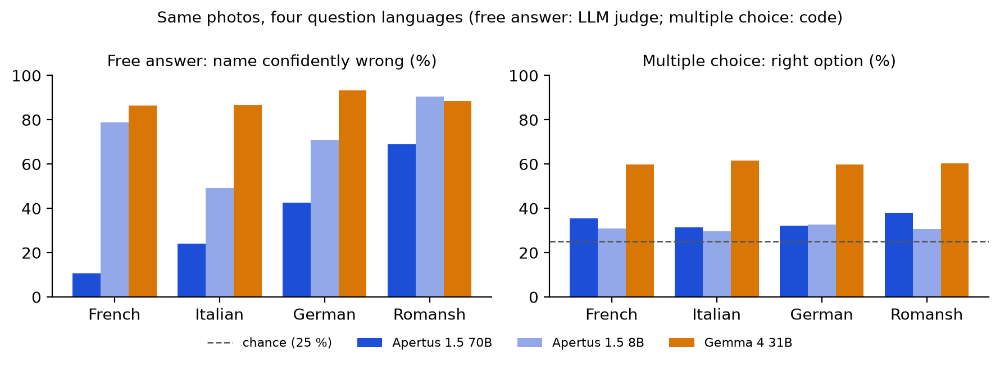

# Technical report — Swiss Heritage Factuality: does Apertus recognise Switzerland's landmarks?

> A visitor points a phone at a Swiss chapel, castle or fountain and asks what it is: we test whether Apertus 1.5
> answers truthfully or invents. Our benchmark has 5,210 questions in French, German, Italian and Romansh on 242
> landmarks of the federal heritage inventory (KGS), with photo, multiple-choice, text-only and trap variants,
> per-item licences, and a frozen LLM judge checked by a blind human audit (κ = 0.76). Apertus 1.5 70B rarely
> recognises a landmark (multiple choice 34 %, chance 25 %; Gemma-4-31B 60 %), and the question's language decides
> whether it admits it: it declines in French (11 % of names wrong) but answers in Romansh (69 % of names and 97 %
> of places wrong), moving half of the non-Graubünden landmarks to Graubünden.

**Track:** Apertus Readiness - Track 1B (Swiss Voices), dimension: core-task intelligence (factuality)  
**Event:** Online  
**Team:** Red Pandas — Christopher Yazigi, Giovanni Yazbeck, Alfredo Pio Yazbeck  
**Demo / data:** dataset `huggingface.co/datasets/chrizzto/swiss-heritage-factuality`\
**Code:** `github.com/ChristoYusj/apertus-swiss-landmarks`

----

### Use of Apertus

- **Model:** `swiss-ai/Apertus-v1.5-70B` (main), `swiss-ai/Apertus-v1.5-8B` (secondary); comparison model
  `google/gemma-4-31B-it` (open weights, Hugging Face router, provider `novita`) on the same items
- **How it is used:** evaluation (multimodal: photo + question)
- **Where it runs:** hosted CSCS inference endpoint (OpenAI-compatible); the harness accepts any
  OpenAI-compatible endpoint via `LLM_NAME`, `LLM_BASE_URL`, `LLM_API_KEY`

----
## Use Case Description

A visitor or a teacher points a phone at a Swiss chapel, castle or fountain and asks "what is this, where is it,
when was it built?". This is a typical use of a Swiss multimodal assistant or tourism chatbot. A confident wrong
answer is costly here: it is believable, about a real place, and the asker usually cannot check it.
Switzerland's heritage is also a clean test of *localised* knowledge: the federal inventory of
cultural property (KGS) lists thousands of objects, most known only locally, across four language regions of very
unequal size.

We measure the **factuality and hallucination** of Apertus 1.5 on these landmarks (SimpleQA-style: correct /
incorrect / not attempted). Four questions were fixed before the run (pre-registration commit
`a73986e`, `docs/analysis_plan.md`): Does Apertus invent more about obscure landmarks (H1)? Are wrong answers
pulled toward the German-speaking majority (H2) or toward famous look-alikes (H2b)? Is the failure one of
*recognition* (photo) rather than *knowledge* (name given) (H3)? Does it accept a false premise in the question
(H4)?

## Dataset Summary

| | |
|--|----------|
| Landmarks | 242 KGS heritage objects (A: 103, B: 133, local: 6) in 4 BFS language regions × 3 fame tiers (264 drawn; 22 removed in the photo screening: 13 AI-led, 9 by a third AI review) |
| Fame tiers | Wikipedia articles: low 0, mid 1–2, high ≥ 3 (20–24 per cell; Romansh region: smaller pools, 12–18, the high-fame cell a census) |
| Types | churches 106, castles 58, museums 28, civic 18, bridges 14, fountains 8, towers/gates 8, monuments 2 |
| Photos | 242 main photos (Wikidata P18), 151 second views, 16 too-generic photos; 500 px, EXIF stripped, per-image licence |
| Questions | 5,210: core 3,274 (`photo_main` 2,196, each photo in 4 languages; `photo_alt` 688; `text_only` 314; `trap_premise` 44; `trap_lowinfo` 32) + registered extensions 1,936 (`photo_mc` 968; `photo_main_w2` 968) |
| Question types | Q1 name, Q2 municipality + canton, Q3 year built (65 landmarks with a precise, unconflicted year) |
| Languages | French, German, Italian, Romansh (Rumantsch Grischun); identical templates, explicit "if unsure, say so"; drafted with Claude Code: FR reviewed by the team, DE/IT back-translated, RM not reviewed (exploratory) |
| Answer keys | Wikidata (CC0) + BFS municipality register. Answer variations: name aliases (flagged if only valid with the town), current/former municipality names, canton names in 5 languages, year windows. Per-item source citation (`gold_source`: Wikidata QID + properties, BFS register) |
| Licences | questions/keys/responses CDLA-Permissive-2.0; photos keep their CC licence (TASL attribution per item) |

**Arms.** `photo_main`: the photo, asked in all four languages (same image, so language is the only change).
`text_only` (FR, DE): the name is given and the place or year asked, separating *recognition* from
*knowledge*. `trap_premise` (false-premise trap): the question asserts the town of a real look-alike in another
municipality ("This building is in Rothrist. Which building is it?"). `photo_alt` (FR, DE): a second view of the
same object, an indirect memorisation check. `trap_lowinfo` (FR, DE): a too-generic photo; declining is right.
Extensions, registered before they were run (`docs/extensions_plan.md`): `photo_mc` (multiple choice): the main
photo with four named options (the landmark and three others of the same type, mostly from the same region;
chance 25 %), in all four languages; `photo_main_w2` (second wording; FR, RM): the name and place questions,
independently reworded.

**Selection funnel** (seed 20261013): 13,417 heritage objects with a photo → 4,153 eligible (public landmark
types, a current municipality, a specific label, one language region) → stratified sample of 264 + 83
same-cell reserves for replacements.

## Data Collection Method

**Sources.** Wikidata (QLever mirror, cached queries in the repository) for objects, names, inception dates and
administrative location; the Federal Statistical Office municipality register (01-10-2026) for municipality
numbers, cantons and language regions; Wikimedia Commons for photos and their licences.

**Answer keys** (rules in code, decisions in `CHANGELOG.md`). Names: Wikidata labels, aliases and sitelinks in
six languages, minus town-only and type-only aliases. A name is *non-distinctive* if nothing remains after
removing type words, saints and the town ("Kapelle St. Antonius"); it then counts only with the right town.
Places: the current municipality's names in all languages (16 district/region/former-municipality labels
removed); shared town names need the canton. Years: unconflicted year- or decade-precision inception (window ±5),
never a museum's founding date. An independent script re-checked 25 random landmarks against live Wikidata
(25/25).

**Question validity rules** (from the question text only): text-only questions are dropped when the given name
is non-distinctive or contains the town or a year (170 items, kept with their answers in
`metadata/excluded_items.jsonl`).

**Annotation** (`docs/annotation_guidelines.md`; deviations from the plan are logged in `CHANGELOG.md`).

- *Photo screening, by AI (deviation: the plan had the team screen).* Rules: exclude recognisable people,
  readable plates, private interiors and personal text (never blur); drop a main photo that does not show the
  object; pick a second view; mark too-generic photos. Claude Opus 5.5 screened all 917 candidates, three further
  instances re-checked the 491 proposed for shipping, and a second AI agent (Hermes) reviewed them under the
  lead's "if unsure, exclude" policy; the lead decided 6 edge cases. 13 landmarks were removed (privacy 4, wrong
  object 4, unclear 5); 429 photos shipped. *Third AI review:* a Gemini agent (Gemini 3.8 Flash) then reviewed
  all 429 (answer-blind: photos only) and flagged 14; the lead accepted the flags: 9 main photos (landmark removed;
  one also with its second view flagged) and, on other landmarks, 3 second views and 1 too-generic photo (only the
  photo removed). 210 questions went (answers kept); the rest are unchanged. No person reviewed every shipped photo.
- *Grading audit (human, blind):* one annotator (A1, the team lead) graded 522 70B answers: the pre-registered,
  stratified 20 % sample (546 of 2,726) minus 24 on landmarks screened out; 499 are still in the dataset and give
  the agreement: 19.5 % of the 2,554 current 70B items in these arms, 15 % of all 70B core items (not covered:
  `photo_alt`, `trap_lowinfo`, extensions, 8B, Gemma). The three blind PDF forms hid the judge's and code grader's
  labels; non-French answers had an English machine gloss. A1 did all three planned annotators' parts (30 shared
  items, a known overlap), so no agreement between people. Hermes graded the sample as an AI cross-check. Full
  AI-use disclosure: `docs/ai_use_statement.md`.

**Consent and personal data.** No person is a data subject: photos with recognisable people are excluded and
EXIF is stripped. Annotator consent form: `docs/consent_form_template.md` (pseudonymous IDs).

## Dataset Details

- **Quality metrics:** answer-key audit (above), selection funnel, per-cell counts, question validity rules,
  stability of answers at temperature 0 (below), judge–code agreement, an AI-assisted re-read of every core
  Apertus disagreement, a blind human audit of 499 70B answers (one annotator) and an AI cross-check.
- **Diversity / edge cases:** four languages incl. Romansh; fame tiers; same-photo language contrast; text vs
  photo; false-premise traps with real look-alikes; too-generic photos; ambiguous town names; non-distinctive
  names.
- **Contamination:** the Apertus pre-training data list names no Wikimedia or landmark image set, but includes
  web-scale image–text corpora that may contain some of these photos; we cannot check at URL level (limitation).
  Our indirect check, the `photo_main` vs `photo_alt` contrast, shows no advantage for the main photos
  (Results 4).
- **Ethics and licensing:** photos with NC/ND/GFDL-only/unknown licences are excluded; every image row carries
  author, licence, source URL and the modification made. Takedown requests: the dataset's discussion page.

## Evaluation

### Method
- **Labels:** SimpleQA three-way. *Hallucination rate* = incorrect / attempted.
- **Graders:** (1) a deterministic code grader on 100 % of items: alias matching with the distinctiveness and
  ambiguity rules, abstention and hedge detection in all four languages, and a gazetteer of all Swiss cantons and
  current and former municipalities. (2) An independent open-weights judge, `openai/gpt-oss-120b` (not Apertus),
  on every free answer, pinned to one provider, temperature 0. Its prompt was tuned on a 40-item dev set (labels
  proposed by Claude; the team lead ruled on the 4 hard cases and accepted the other 36 without item-by-item
  review; deviation: the plan had the team label it); the final prompt reached 40/40 agreement, two runs identical, and was frozen before the full run and
  the audit sample. Final label = the judge's (for 4 empty Gemma verdicts: the code grader's). Multiple choice is
  graded by code only (one option named by letter or text).
- **Statistics:** cluster bootstrap over landmarks (2,000 resamples) for CIs; exact McNemar for paired contrasts;
  Holm correction across the registered tests; Wilson intervals for rates.

### Evaluation setup and inference parameters
Temperature 0, top_p 1, max_tokens 300, seed 1234, one image (base64 JPEG) + one question, no system prompt.
Every response is stored with a content hash of its request; `verify` replays the stored answers.
**Stability:** 100 items were re-asked once and a random 20 of them twice more. On the first re-ask, 75 % of the 100
answers had identical text and **99 % an identical code label** (κ = 0.98; the one change: a vague hedge that, asked again,
named two candidate cantons). All 20 probe items kept their label over four answers. The endpoint is not
bit-for-bit deterministic, but the grades are stable.

### Results

**1. The question's language decides whether the model answers, not what it recognises.**

| photo_main, Apertus 70B (n per cell = 242) | FR | IT | DE | RM |
|---|---|---|---|---|
| Name: not attempted (declines, or too vague to check) | 89 % | 76 % | 57 % | **31 %** |
| Name: confidently wrong | 11 % | 24 % | 43 % | **69 %** |
| Place: confidently wrong | 2 % | 2 % | 31 % | **97 %** |

Only 4 of 968 names and 6 of 968 places are right; 354 of 358 committed names are wrong. The same instruction
("if you are not sure, say so") gives honest refusals in French and confident fabrication in Romansh, on
identical images. **With multiple choice** (`photo_mc`, four named options) the language gap disappears (Figure 1): 70B
picks the right landmark in 31–38 % in every language (34.3 % overall, 95 % CI 29.4–39.4 resampling landmarks;
chance 25 %), 8B in 30–33 %; no answer named a landmark outside the four options. Part of the margin over chance is a position bias: 70B starts with "A" in 57 % of
answers and is right in 73 % when the correct option is A, about 22 % otherwise (still above the ~14 % a pure
"A" bias would give). So recognition is weak in every language. **The second wording** (`photo_main_w2`,
registered before the run for 70B, also run on 8B and Gemma) keeps the gap: 70B gets 94 % of Romansh names wrong
vs 20 % of French. The 8B model is very sensitive to wording (French names wrong 79 % → 33 %), but Romansh stays
its worst language (81 %). Gemma-4-31B has no such gap: it rarely declines (names not attempted 5–11 %), gives a
wrong name in 86–93 % of answers in every language, and in multiple choice is right 60 % of the time (95 % CI
55.2–65.8; 60–62 % in every language). It recognises far more than Apertus but does not say when it does not
know. The language-dependent caution is an Apertus trait (both sizes, strongest in 70B).

{width=100%}

**2. In Romansh the model moves landmarks to Graubünden** (exploratory, location extracted with the gazetteer).
Of 181 landmarks outside Graubünden, the Romansh answers place **94** in Graubünden; the French and Italian
answers for the same photos place none there, the German answers 14 (paired McNemar RM vs FR/IT/DE,
p < 10⁻⁶). Overall, 62 % of Romansh place answers say Graubünden (true share 25 %), mostly naming German- and
Italian-speaking towns (91 of 135 named; e.g. Chur, Roveredo, Poschiavo). The pull is toward the canton
associated with Romansh, not toward Romansh-speaking villages. The 8B model shows the pull more weakly (36 %). Gemma shows it too (57 % of its Romansh place answers say Graubünden; 89 of the 181 non-Graubünden
landmarks), so this is a cross-model association of Romansh with Graubünden, not an Apertus quirk.

**3. Famous names absorb unknown objects.** Eleven different landmarks, mostly castles, are called "Castel
Tarasp" (the famous Engadine castle) and eight "Castle Vaduz" (Liechtenstein); in French and Italian answers,
castles become "Château de Chillon". Disentis Abbey becomes "Kloster Einsiedeln".

**4. A second view and a too-generic photo** (descriptive, FR + DE). On the 151 landmarks with a second view,
70B names 2 landmarks correctly from the main photo and 1 other (in both languages) from the second view. It does
not do better on the main photo (wrong, second view vs main photo: names 23 % vs 27 %; places 12 % vs 17 %,
McNemar p = 0.03 on places): no advantage for the Wikidata main photos, so no sign that they were memorised. On 16 too-generic
photos, 70B declined all 32 times and 8B 31 of 32, although on the main photos of the same landmarks they gave
wrong names 7 and 24 times. The models can tell a too-generic photo from a recognisable one, but a photo that
*looks* identifiable triggers a confident guess.

**5. Registered hypotheses** (Holm-adjusted):

| | Result |
|--|----------|
| H1 fame cliff (name) | not supported: hallucination 97.4 % (low) vs 99.2 % (high); floor effect |
| H1b fame cliff (place) | not supported (Δ = +2.4 pp, CI −0.9 to +6.2) |
| H2 majority-region pull | not supported: wrong towns for non-DE landmarks are 59 % German-speaking vs 65 % of all municipalities (registered comparison points the other way, p_Holm = 0.19) |
| H2b famous look-alike | not testable: 3 answers (1 landmark) name a look-alike's town |
| H3 seeing vs knowing (place) | **supported in French** (text 8 vs photo 0 correct of 92 landmarks, p_Holm = 0.04), same direction in German (9 vs 1, p_Holm = 0.09). Fragile: before the AI screening removed 13 landmarks, French was 8 vs 1 (p_Holm = 0.13) |
| H4 false premise | **supported**: 80 % adopt the false town vs 30 % incorrect on the same photo asked plainly (p_Holm < 0.0001); counting a wrongly named building as incorrect too (team rule), 89 % |

Knowing the name helps, and there fame matters: with the name given, place accuracy is 12.8 % for high-fame vs
3.8 % for low-fame landmarks; from the photo, both are ≈ 0 %. The bottleneck is visual recognition (Figure 2).

{width=100%}

**6. Smaller model and comparison model.** Apertus 1.5 8B declines less (names not attempted: 27 % vs 63 % for
70B) and is confidently wrong more often in every language (names wrong: FR 79 %, IT 49 %, DE 71 %, RM 90 %). The
false premise does not mislead it more than the plain question (73 % vs 86 %, n.s.), because it is already wrong
on the plain question. Gemma-4-31B (names: 9 % not attempted, 89 % wrong) names the landmark in 24 of 968
answers (12 landmarks; Apertus 70B: 4 answers, 3 landmarks) and has a significant fame effect (H1: 99.6 % vs
93.7 % hallucination, low vs high fame; H1b likewise; p_Holm 0.01–0.03), as does 8B on places (H1b: 98.8 % vs
93.0 %; p_Holm = 0.03; 0.07 before the third photo review). Gemma invents a name for 25 % of the too-generic photos
(70B: 0 %) and adopts the false town in 66 % of false-premise traps.

**7. Agreement and judge errors.** Judge vs code grader on the 3,274 core items: κ = 0.95 (70B; 97.9 % identical
labels), 0.94 (8B; 96.8 %), 0.92 (Gemma; 97.2 %). Every core disagreement of the Apertus models was re-read
independently against the written rules, with a second blind read where the judge looked wrong (236 re-reads
over two rounds, 216 still in the dataset; `disagreement_adjudication.jsonl`; AI-assisted, not a human audit).
Of the 216, the judge was right in 84, the code grader in 125, neither in 1, and 6 stayed unsettled.
Second-wording and Gemma disagreements were not re-read. The judge is too strict on vague answers whose building
type fits the landmark and on saint names without a town, and labels vague centuries outside the year window as
not attempted. Replacing its label wherever the re-read settled it lowers the Romansh name-wrong rate from 69 %
to 60 % (70B; 8B 90 % → 81 %), raises the small Romansh year cell by 5 pp and lowers the false-premise trap rate
from 89 % to 84 %; no other 70B language × question cell moves by more than 1.7 pp. The registered results
keep the frozen judge's labels. *Human audit* (blind, one annotator, 499 answers): judge vs human κ = 0.76 (89 %
identical), code grader vs human κ = 0.73 (87 %). Most disagreements are answers the judge counted as declines
but the annotator marked incorrect (29), and answers the annotator marked correct but the judge did not (18). 27 of
the 30 shared items are still in the dataset; each got the same label all three times. *AI cross-check* (Hermes;
481 of the 499, 18 left unscored): κ = 0.96 with the judge (98.3 % identical), 0.99 with the code grader.

## Dataset Limitations
- Results use one template per language (plus a second wording in FR and RM). The Romansh templates were not
  reviewed by a native speaker (exploratory). The language effect could partly reflect template wording; a
  variant without the abstention cue is future work.
- Gold comes from Wikidata, so its errors propagate. Mitigations: the rule-based checks, the 25-landmark live
  re-check and the AI-assisted re-read of every core Apertus grader disagreement against the gold. The photo
  screening also found one Wikidata main photo of the wrong building (removed).
- Fame is proxied by Wikipedia article counts. Low accuracy everywhere limits the power of fame contrasts (floor).
- Neither automatic grader is perfect. For the judge's errors, see Results 7. The code grader (second rater)
  misses fine-grained contradictions: Romansh "house of X" phrases, a denomination the gold does not state,
  name-shaped phrases built from common nouns ("Tour de l'Horloge" for another tower), and descriptive museum
  names.
- Corrections to the code grader and question validity were made after seeing answers; each is documented with
  its effect in `CHANGELOG.md` and pinned by regression tests. A second independent review read every answer the
  code grader marked incorrect and moved 109 (70B) and 356 (8B) labels, mostly refusals phrased in ways the
  patterns did not know; a third read 831 labels, and its fixes moved 14 (70B) and 29 (8B) more. Every changed
  label was read individually; these reviews were AI-assisted, not a human audit.
- With one annotator, the human audit cannot report agreement between people. The annotator's labels depart from
  the written rules in places (declines marked incorrect), which lowers the judge–human agreement.
- Photos were screened by AI (Claude, Hermes, then a third review by Gemini whose 14 flags the lead accepted);
  the lead decided edge cases, but no person reviewed every shipped photo. Some third-review removals are
  precautionary, beyond the written privacy rule (e.g. a shop-window mannequin, a museum interior). 3 of the 4 landmarks screened out for privacy were busy town-centre
  scenes (holding 3 of the 70B's 9 correct place answers from photos; H3). The 9 removed in the third review held no
  correct 70B free answer (multiple choice: 16 of 36 right).

## Lessons Learnt and Recommendations
- For Apertus: its visual knowledge of Swiss landmarks lags a comparable open model (multiple choice 34 % vs
  60 % for Gemma-4-31B). Its strength is calibration (declining instead of guessing in French and Italian), and
  Romansh breaks it. Calibration training should include Romansh and German, and objects that look recognisable
  but are unknown; retrieval (e.g. a KGS/Wikidata lookup) would help recognition more than more text.
- For the dataset: a person checking every photo, a second human annotator, native-speaker review of the
  Romansh templates, a wording without the abstention cue, and URL-level contamination checks.
- For evaluators: score abstention separately from accuracy and compare languages on identical images; check
  hedged answers ("not sure, but it seems to be a church") — they are abstentions, not errors.

## Reproducibility
`make run` (Docker) on a clean checkout builds the image, downloads the pinned dataset revision from Hugging Face
and runs `verify` on the reference results, Apertus 70B (schema, image hashes, coverage, the code grader
reproduces every stored code label, final-label rule, recomputed scores equal the expected scores). If `LLM_*` is set, it also evaluates that model on a stratified
sample (`FULL=1` for all items), graded by the judge if `JUDGE_MODEL=openai/gpt-oss-120b:groq`,
`JUDGE_BASE_URL=https://router.huggingface.co/v1` and `JUDGE_API_KEY` are set (else by the code grader alone). Hardware: any CPU; runtime ≈ 1 min for verification, under an hour for a full
70B run at 4 parallel requests. Seeds: selection 20261013, sampling 7, bootstrap 20261015, stability 20261016,
audit 20261017. Dataset revision `26d86b35d1a6` (pinned in `config.json`; the first release, 3,412 core items; the re-release
with the extensions and the photo review is pending); code: branch `build` (the `main` branch and a new tag
follow at the re-release).

## License
Code: Apache-2.0. Dataset: CDLA-Permissive-2.0 (photos under their own CC licences, listed per item).
Report: CC-BY-4.0.

## References
SimpleQA (Wei et al., 2024); Wikidata; Swiss Inventory of Cultural Property of National and Regional
Significance (KGS); BFS Swiss official commune register; Apertus technical report (Swiss AI Initiative, 2025).
